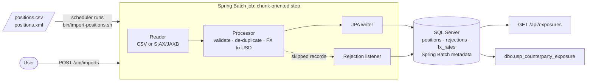

# RiskFeed: batch ETL for trading positions (Java, Spring Batch, SQL Server)

[](https://github.com/Stuart-Vision/riskfeed/actions/workflows/ci.yml)

Trading systems drop **position files** (CSV or XML) at the end of each business day. RiskFeed loads them into **SQL Server**:
- it validates every record;
- converts market values to USD with that day's FX rates;
- keeps bad records out with the reason they failed.

Risk users then query **counterparty exposure** through a REST API or a T-SQL stored procedure.

**Java 21 · Spring Boot 3.5 · Spring Batch 5 · Spring Data JPA (Hibernate) · SQL Server · Flyway · JUnit 5 · Maven**



## What it does

**One step, many chunks.** The reader feeds records in chunks (500 by default). Each chunk commits in its own transaction, so a large file never holds one huge transaction open.

**Bad records don't stop the file.** The step is fault-tolerant. A record that fails validation is *skipped*: the listener saves it to `rejections` with its line number and every reason it failed, and the rest of the file still loads. These are rejected:
- a trade id, book, product or currency in the wrong format;
- an **LEI** with wrong check digits, checked with ISO 17442 / ISO 7064 MOD 97-10, the same scheme as IBAN;
- a notional that isn't positive, or an amount that isn't numeric or has more than 2 decimals;
- an invalid date or one in the future;
- a currency with no FX rate for that day;
- a trade that appears twice in the file, or was already loaded by an earlier file.

**The same file is never loaded twice.** The file's **SHA-256** is the job's identifying parameter, so re-sending the same content is refused even under a different file name.

**Money is `BigDecimal`.** USD values are rounded HALF_EVEN (banker's rounding) to 2 decimals.

### A Spring Batch detail worth knowing

When a record in a chunk is skipped, Spring Batch **rolls the chunk back and processes its other records again**. The first version of the "duplicate trade in this file" check remembered every trade it had seen. On that second pass, valid records were flagged as duplicates of themselves, and only 7 of 8 good records loaded. The check now remembers *which record* first used each trade id, so a re-processed record is recognised. The tests caught this.

## Run it

```bash
mvn -B verify                                  # build + 32 tests
java -jar target/riskfeed-1.0.0.jar            # API on :8080, H2 database in ./data (SQL Server mode)

curl -F "file=@samples/positions-2026-10-21.csv" localhost:8080/api/imports
curl localhost:8080/api/imports/1/rejections
curl "localhost:8080/api/exposures?asOfDate=2026-10-21"
```

### Scheduled imports (Control-M, Airflow, cron)

```bash
bin/import-positions.sh samples/positions-2026-10-21.csv
```

The script runs the import without the web server and returns an exit code the scheduler can act on:

| Code | Meaning |
| --- | --- |
| 0 | loaded cleanly |
| 3 | loaded, but some records were rejected |
| 2 | already imported (safe on a re-run) |
| 1 | failed: alert and retry |

### SQL Server

```bash
SPRING_PROFILES_ACTIVE=sqlserver DB_HOST=... DB_NAME=riskfeed DB_USER=... DB_PASSWORD=... \
  java -jar target/riskfeed-1.0.0.jar
```

Flyway applies `db/migration/sqlserver` on start-up. Those scripts include:
- a **covering index** for the exposure report, `(as_of_date, counterparty_lei) INCLUDE (market_value_usd)`;
- the stored procedure **`dbo.usp_counterparty_exposure @AsOfDate, @MinGrossUsd`**.

## API

| Method | Path | |
| --- | --- | --- |
| `POST` | `/api/imports` | Upload a `.csv` or `.xml` file (multipart `file`) and import it. Returns `201` with read, loaded and rejected counts, or `409` if already imported |
| `GET` | `/api/imports/{id}` | Status and counts of an import (from Spring Batch metadata) |
| `GET` | `/api/imports/{id}/rejections` | Rejected records with line numbers and reasons |
| `GET` | `/api/exposures?asOfDate=` | Net and gross USD exposure per counterparty, largest first |
| `GET` | `/actuator/health` | Health check |

Errors are RFC 9457 `application/problem+json`.

## File formats

```csv
tradeId,book,counterpartyLei,product,currency,notional,marketValue,asOfDate
FXD-1001,FX_SG,5493001KJTIIGC8Y1R12,FX_FORWARD,SGD,5000000.00,125000.00,2026-10-21
```

```xml
<positions>
  <position>
    <tradeId>LN-4101</tradeId><book>LENDING</book><counterpartyLei>969500ZXCVBNMASDFG86</counterpartyLei>
    <product>LOAN</product><currency>SGD</currency><notional>12000000.00</notional>
    <marketValue>11950000.00</marketValue><asOfDate>2026-10-22</asOfDate>
  </position>
</positions>
```

The `samples/` files mix good records with one example of each kind of bad record.

## Tests

`mvn verify` runs **32 JUnit 5 tests**:

- **Unit tests:** LEI check digits, and every validation rule as a parameterised test, including a record with several problems at once.
- **Batch job tests** run the real Spring Batch job against H2 in SQL Server mode, with chunks of 3, so files span several transactions. They check:
  - the counts for each sample file;
  - each rejection's line number and reason;
  - USD exposures matching values worked out by hand;
  - the same file refused under a new name;
  - a trade already loaded by an earlier file being rejected;
  - a short CSV row rejected without stopping the import;
  - a malformed XML file failing the job.
- **API tests** with MockMvc: upload, status, rejections, exposures, `409` on a repeat upload, `400` for unsupported or empty files and bad dates, and `404` for an unknown import.

**SQL Server is tested for real in CI.** GitHub Actions starts **SQL Server 2022** in a container and runs the packaged JAR through `bin/import-positions.sh`:
- the CSV sample, expecting exit code 3;
- the same file again, expecting 2;
- the XML sample, expecting 3.

It then runs `dbo.usp_counterparty_exposure` and checks its figures. The SQL Server scripts were also run by hand against SQL Server 2025 Express.

## Project layout

```
src/main/java/.../batch/     job and step, CSV/XML readers, processor, rejection listener, import service
src/main/java/.../domain/    validator, LEI check, JPA entities and repositories, FX rates (JdbcClient)
src/main/java/.../web/       REST controller, problem+json errors
src/main/java/.../cli/       --import command and exit codes
src/main/resources/db/migration/{sqlserver,h2}/   Flyway scripts per database
bin/import-positions.sh      scheduler entry point
.github/workflows/ci.yml     build + tests, then end-to-end on SQL Server 2022
Jenkinsfile, .gitlab-ci.yml  equivalent pipelines for Jenkins and GitLab (not run here)
```
